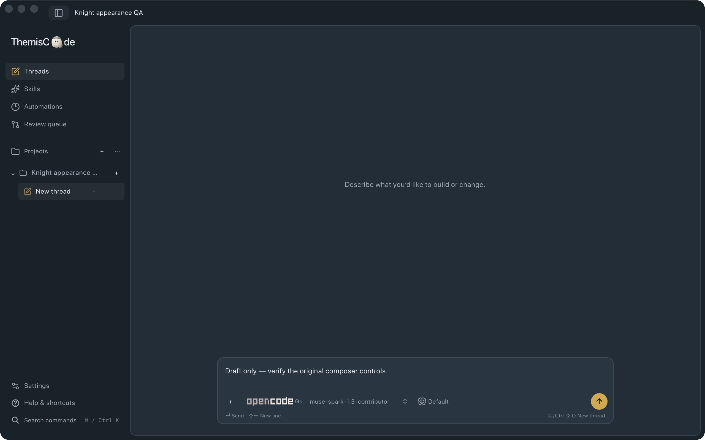
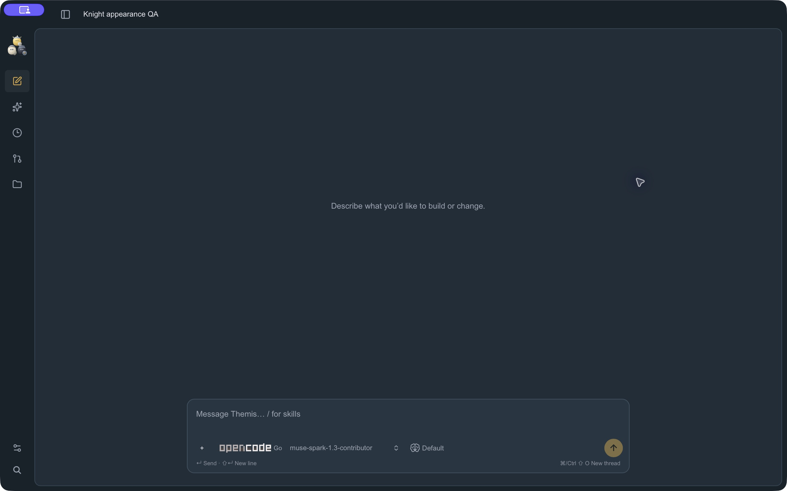

# Desktop appearance

ThemisCode keeps its existing workspace and composer. A permanent icon rail contains Chats, Integrations, Automations and Review queue, then Settings, Help and Search, each with a tooltip. The expandable dock contains the glinting Themis wordmark, a New chat pill, projects and their threads. The top toggle and Cmd/Ctrl+B collapse only that dock; hovering never expands it. Native icons and the favicon remain. The default Classic palette uses neutral greys (frame `#0e0f10`, sidebar `#262729`, canvas `#212225`, surface `#2a2b2f`, raised `#323438`) with the gold accent `#d9a73e` and a warm gradient (`#d0a660` → `#e3b85a` → `#f6e7bd`) reserved for the greeting, the active-run composer ring, the context warning and review progress.

All new projects are created under the fixed `~/ThemisOS/Projects` root. The default **Themis** project remains first in the sidebar at `~/ThemisOS/Projects/Themis`, without a lock icon. All project display names, including Themis, can be changed without moving their folders or histories. Settings shows only the shared projects root. Settings and creation dialogs offer no location override.

Settings › Appearance offers five cards, in this order: **Auto**, **Morning**, **Noon**, **Night** and **Classic** (the dark Themis look, and the default). Each card shows a preview of its sky with the name below; the chosen one has an accent ring and `aria-pressed`. Morning and Noon are light, so the preset decides the light or dark mode (`data-theme`); the separate Light/Dark/System setting stays retired, Apply no longer sends it, and the server keeps it Dark. The 16 solid dark presets (GitHub Dark, GitHub Dimmed, Midnight, Nordic, Graphite, Ink, Forest, Copper, Plum, Ocean, Rosewood, Olive, Amethyst, Terminal, Sandstone, Carbon) and the old `warm` and `violet` ids are removed with no alias: the server refuses them, and a saved one, the old `system` id or any unknown id shows and loads as Classic. Choosing a sky no longer changes the font. There are 12 locally resolved font choices: System, Arial, Georgia, Mono, Rounded, Avenir, Helvetica, Verdana, Trebuchet, Palatino, Charter and Menlo. Font fallbacks apply where a family is unavailable. Code stays monospace. Size ranges from 12 to 22px.

Themes, fonts and sizes preview throughout the interface before saving. **Apply** persists the draft through the shared server; **Revert**, leaving Settings or a failed write restores the saved appearance. Shared action buttons use unboxed text or icons, and settings labels stay compact.

Overflowing project and thread titles make one leftward pass on hover or keyboard focus, retaining the full accessible title. Reduced-motion mode wraps titles and disables shimmer/motion.

Sidebar SVG paths use Lucide icons; see `docs/lucide-icons-LICENSE`. The app icon is the Themis Visions mark's dark tile (`crates/desktop/icons/icon.svg`, from the canvas Logo board; `icon-light.svg` is kept unused, since a bundle takes one icon). Render `icon.svg` to the 1024px `icon-source.png` and regenerate every bundle icon (PNGs, ICNS, ICO, Android, iOS, Windows Store) with `npx tauri icon crates/desktop/icons/icon-source.png -o crates/desktop/icons`; macOS follows its own template instead: `icon-macos.svg` puts the tile in an 824×824 body (radius 185) with a 100px transparent margin and a soft shadow; `icon.icns` and `Themis.iconset` are built from its 1024px rendering with `sips` and `iconutil -c icns`, and the runtime Dock icon uses the iconset's 256px image. Windows and Linux keep the full tile. The favicon is the same SVG (`web/src/assets/themis-visions.svg`).

Selected threads shimmer without a colored side stripe. The frame (top bar, rail and the gaps around the panels) sits furthest back and the panels stand clearly off it: a test holds the sidebar and the stage at least 1.25:1 luminance contrast from the frame on light skies and 1.2:1 on dark ones (Classic, Night), measured at the sky's middle stop, for the glass and for the solid panels alike. The layout is framed: the rail sits flush on the frame, and the sidebar dock, the chat stage and the Workspace panel are rounded panels inset by `--themis-panel-gap` (8px), with radii `--themis-stage-radius` (18px) and `--themis-panel-radius` (20px). `--themis-panel-bg` (defaults to the sidebar colour), `--themis-stage-bg` (defaults to the canvas) and `--themis-panel-blur` (`none`) let a theme restyle the panels without touching geometry. Every preset also draws its panels as lit glass: the side panels (the chat sidebar, the Settings section list, the Workspace panel) get `--themis-panel-sheen` (a 140deg gradient from the highlight at -45% to transparent at 28%) over their tint and `--themis-panel-edge` (an inset 1px top highlight, an inset 1px ring and a `0 10px 36px` drop shadow); the stage gets `--themis-stage-edge-shadow` (an inset 1px edge ring and the top highlight). `appearance.ts` sets `--themis-panel-highlight`, `--themis-panel-ring`, `--themis-panel-shadow` and `--themis-stage-edge` per preset; Classic uses a faint highlight, no ring, a dark shadow and a `#34363b` stage edge.

A sky paints `--themis-sky` behind the frame: a translucent frame tint over two soft radial glows over a vertical gradient (Morning `#A9CFF7` → `#BED8F5` → `#FFD6B8`, Noon `#6DB6F7` → `#A9D6FB` → `#E4F3FF`, Night `#04060E` → `#0A1024` → `#141C44`). The frame tint is low, so the sky shows through around the panels (Morning `rgba(235,246,255,.1)`, Noon `rgba(244,250,255,.12)`, Night `rgba(4,6,14,.35)`). Its `glass` sets `--themis-panel-bg` and `--themis-stage-bg` to translucent colours (panel / stage: Morning white at .66 / .84, Noon white at .62 / .78, Night `rgba(40,54,96,.5)` / `rgba(32,43,78,.72)`), and on macOS `--themis-panel-blur` to `blur(36px) saturate(190%)`. Each sky's opaque colours are stand-ins for that glass over the gradient's middle stop and are what menus, inputs and cards use. The accents of Morning (`#0052ab`) and Noon (`#004494`) are darker than the design board's so they reach 4.5:1 on the frame, where the sky shows through; tests check text, secondary text, accent and the status colours on the frame, the panels (with their sheen) and the stage over every stop, with and without the glows. Light skies use darker status colours (success `#11522a`, warning `#78340b`, danger `#8d0f33`, info `#034394`) and light compatibility-badge colours; the gold gradient becomes a deep bronze-to-amber ramp (`#4d2c02` → `#5c3604` → `#693e00`) whose every stop reaches 4.5:1 there. Night's danger (`#f4968d`) and first gradient stop (`#d0a660`) are lighter for its brighter panels, and Classic shares them.

**Auto.** `auto` is a palette id the person saves, not a preset: the app resolves it to Morning, Noon or Night by local time (`skyFor`: morning 05:00-10:59, noon 11:00-18:59, night 19:00-04:59) and re-checks once a minute (`useAutoSky`), so the app repaints exactly once at a boundary. It is listed first in Settings › Appearance, and its card shows the day from morning to night; Classic's card shows its sidebar, canvas and frame as bands. The whole app previews a choice until Apply or Revert. The Rust allow-list accepts `auto`.

**Glass on every OS.** The skies and their simulated glass (translucent tint, sheen, highlight, ring and shadow) are the same on macOS, Windows and Linux. Real backdrop blur is only an extra on macOS, where its frame time is measured, and only where the web view supports `backdrop-filter`; elsewhere the panels look the same without blur. When the system asks to reduce transparency (macOS Accessibility › Display › Reduce transparency, `prefers-reduced-transparency`), `data-glass="off"` turns the panels solid (the sidebar and canvas colours, no blur) while they keep their ring and shadow and the sky still shows around them. The change listener re-applies the appearance when the reduced-transparency setting changes while the app is open.

Product rules: [UI rules](ui-rules.md).

Current verification: [UI polish checks](ui-polish-verification.md).

## Historical verification

The dated checks below describe earlier builds, including appearance modes and artwork that have since been removed.

## Local verification (2026-10-01)

- `npm --prefix web test`: 178 tests passed in 22 files, including collapse/navigation, palette/font persistence, contrast and existing composer Enter/IME behavior.
- `npm --prefix web run lint` and `npm --prefix web run build`: passed. Build retains the existing large-chunk warning.
- `cargo fmt --all -- --check` and `cargo clippy --workspace --all-targets -- -D warnings`: passed.
- `cargo test -p themis-desktop settings:: --lib`: 8 passed, 75 filtered.
- `cargo test -p themis-desktop --test server_cli_e2e appearance_preferences_roundtrip_through_server_and_cli`: 1 passed, 8 filtered. Checks persisted values and rejects unknown fonts without overwriting saved preferences.
- `python3 -m unittest quality_dashboard.test_dashboard`: 13 passed; `ruff check quality_dashboard`: passed.
- `tauri icon` (CLI 2.12.2): the 1024px RGBA master renders the canvas's dark tile; ICNS, ICO and every PNG set regenerated from it.
- Isolated native QA app (`ai.themis.designqa`, Vite frontend) verified expanded/collapsed navigation, saved Light/Dark appearance, palette changes, project creation and retained composer draft/model/effort/send controls. No provider request was sent. Native Serif/22px rendering and saving also passed; drag/window-control interaction remains unverified; production installation was not replaced.

The refreshed dashboard reports mean cyclomatic complexity 2.11, cognitive complexity 1.55 and maintainability 73.2 across 83 app source files. Touched settings/sidebar/app modules were reviewed; no before/after baseline was captured. The existing LCOV report shows 83.1% Rust coverage, but was not regenerated for this change and is not fresh coverage evidence.

Native QA screenshot (synthetic project and unsent draft):

## Combined plugin integration verification

The plugin branch is integrated with the Framed rail. The inline skill editor uses the existing composer surface and controls. Shift+Enter keeps its newline behavior; empty skill results do not trap Tab or Enter. Marketplace updates refresh an existing plugin's source, and imported Unix executable resources retain owner-only execution after materialization.

Fresh combined checks: 225 Rust tests passed (2 ignored and the existing named Keychain exclusion), 183 web tests passed, web lint/build and workspace Clippy passed, and all 13 dashboard tests/Ruff passed. The shared-server CLI plugin CRUD and appearance persistence journeys both pass. AST averages after including plugin modules: cyclomatic 2.46, cognitive 2.21, maintainability 73.8 across 94 files; the broader plugin code increases complexity compared with the redesign-only scope. Remote marketplace refreshing is source-verified with local-fixture update coverage; no remote marketplace installation or live provider request was used as acceptance evidence.

Combined native QA also verified local plugin creation, /create autocomplete, inserting a stable skill chip, plain-text paste and Shift+Enter multiline drafting. The Plugins refresh clears transient load errors after a successful reload. IME is covered by automated tests; native IME and window dragging remain unverified.

Hover expansion and its Appearance control are removed. The compact rail remains visible until explicitly expanded; a regression checks pointer entry with old hover-enabled settings, navigation from the rail, and reopening with the top toggle. All 183 web tests, lint/build and 13 dashboard tests/Ruff passed after this correction.

