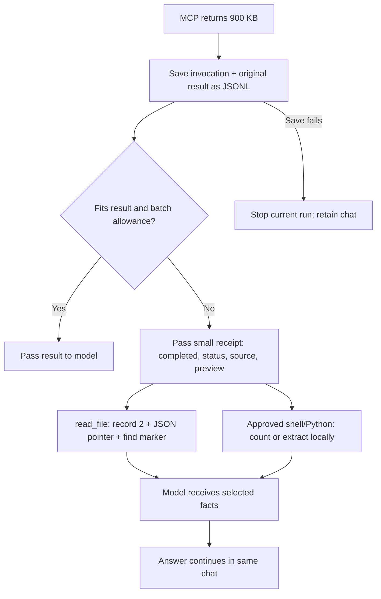

# Bounded tool context — 2026-10-09

Implementation branch: `codex/bounded-tool-context`, based on synchronized `main` at `0f4dfa2`. Final fetch confirmed local `main` and `origin/main` have no divergence. Implementation commits: `0b28487`, `0dda679`, `ef006e8`.

The common Rust run loop journals each returned tool result, then limits what enters model context. This includes native tools, management tools and MCP tools. Small results remain unchanged; large results become receipts with completion and known status fields, a preview and exact original coordinates. The runtime does not retry a completed action merely to recover its output; receipts also tell the model to continue from completed work. Oversized tool arguments are rejected before execution rather than partially written. Default reads return at most 4,000 content characters. Approved local scripts process large files and print only relevant facts.



Illustrative two-record journal (the example text stands in for the full output):

```jsonl
{"role":"Assistant","message_type":{"ToolUse":[{"id":"blob","type":"function","function":{"name":"mcp_blob","arguments":"{}"}}]},"content":""}
{"role":"Tool","message_type":{"ToolResult":[{"id":"blob","type":"function","function":{"name":"mcp_blob","arguments":"{\"content\":[{\"type\":\"text\",\"text\":\"full original output\"}],\"isError\":false}"}}]},"content":""}
```

The receipt points to `.themis/context/CHAT/snapshot-VERSION.jsonl`, one-based record `2`, pointer `/message_type/ToolResult/0/function/arguments`. That field is a string; decode it as JSON when valid. It is an original tool observation, not an assistant summary.

Limits and failure behavior are specified in [context checkpoints](../context-and-attachments.md). Summaries are lossy. Byte/token estimates are approximate. Existing shell/git capture can truncate at 32 KiB before journaling; redirect large output to a file to preserve it. Current reads bound delivery, not memory or disk I/O. Recovery detection is run-local and limited to explicit archive paths; it does not prove semantic progress.

## Verification scope

The CLI end-to-end fixture uses the real `themis` binary, shared app server, runtime, MCP HTTP negotiation/calls, filesystem reads and Python execution. Model responses and the MCP service are scripted loopback fixtures, with a synthetic key and isolated data directories. No real credentials or production chat state are used. It checks:

- Counts/enablement without returning a 240 KB bundled file.
- A 900 KB MCP response remains intact in its journal, while each model request stays below 100 KB and selective recovery obtains the marker without compaction.
- Python processes 10,000 JSONL records and writes 300,000 characters while returning only counts.
- A successful MCP result cannot forge rejection of its executed invocation.
- Recovery coordinates work when the project is beneath an ancestor named `.themis`.

Core regressions cover serialized Unicode/escaping and batch limits, unchanged small results, rejected oversized writes, oversized tool definitions, repeated archive reads, failed evidence saves, Stop boundaries, actual context pressure and checkpoint persistence. Older whole-file-read fixtures now use large assistant narration to cause real context pressure; archived narration is summarized rather than restored wholesale with a completed invocation.

Native UI and autonomous live-model choices are unverified for this patch. No UI code changed. Automated recovery benchmarks and ignored public/provider acceptance tests remain separate audits, not runtime guarantees.

## Commands and results

| Command | Result |
| --- | --- |
| `cargo fmt --all -- --check` | Passed |
| `cargo clippy --workspace --all-targets -- -D warnings` | Passed |
| `cargo test -p themis-core --test runtime_e2e` | 16 passed; 1 live-provider test ignored |
| `cargo test -p themis-desktop --test attachments_e2e` | 6 passed, including the new four-scenario CLI fixture |
| `cargo test -p themis-desktop --test server_cli_e2e` | 13 passed, including headless desktop restart and cancellation |
| `cargo test -p themis-desktop --lib inventory_returns_counts_without_bundled_content` | 1 passed |
| `cargo test -p themis-core --lib tool_delivery_offloads_large_results_and_bounds_the_batch` | 1 passed |
| `npm --prefix web run lint` | Passed |
| `npm --prefix web test` | 306 passed in 29 files |
| `npm --prefix web run build` | Passed; existing Vite large-chunk warning remains |
| `ruff check quality_dashboard` | Passed |
| `python3 -m unittest quality_dashboard.test_dashboard` | 14 passed |

| Full verification command | Result |
| --- | --- |
| `cargo test --workspace -- --skip entered_keys_survive_new_store_and_can_be_forgotten` | 353 passed, 0 failed; 3 ignored (2 acceptance tests and 1 documentation example); 1 explicitly excluded |
| `cargo llvm-cov --workspace --lcov --output-path coverage/lcov.info -- --skip entered_keys_survive_new_store_and_can_be_forgotten` | 353 passed, 0 failed; 2 ignored; 1 explicitly excluded. Fresh LCOV saved: 19,745 / 22,269 lines, 88.7% |

During verification, a marketplace scan-lock test failed once and passed on its focused rerun and subsequent workspace runs. The instrumented headless startup initially missed its five-second readiness window; the fixture now permits bounded cold startup (up to 300 readiness polls). The stop-compaction fixture now leaves room for schemas while retaining its oversized request and one-second Stop assertion. Other development failures exposed old whole-file fixture assumptions and archive-check parsing assumptions; those checks were corrected and the focused suites above rerun. The documented host synthetic-Keychain test is excluded from final workspace/coverage commands; live-provider/public-download acceptance tests retain their ignored status.

## Code health

Refreshed the running dashboard through `http://127.0.0.1:4178/api/metrics`. The configured rust-code-analysis 0.0.25 analyzed 107 app source/test files. Overall averages remain cyclomatic 2.56, cognitive 2.24 and Visual Studio maintainability 73.5 when rounded. Scope includes Rust inline `#[cfg(test)]` code. The baseline is `0f4dfa2`, analyzed separately from a temporary Git archive with the same analyzer.

| Module | Cyclomatic before → after | Cognitive before → after | Maintainability before → after |
| --- | --- | --- | --- |
| core runtime | 2.50 → 2.54 | 2.03 → 2.18 | 67.8 → 68.5 |
| core tools | 2.01 → 2.01 | 0.79 → 0.79 | 70.0 → 69.8 |
| core plugins | 2.96 → 2.80 | 2.30 → 2.05 | 74.8 → 75.3 |
| desktop integration tools | 2.07 → 2.06 | 0.78 → 0.81 | 73.3 → 73.2 |
| desktop plugin API | 10.23 → 10.38 | 5.09 → 5.09 | 74.0 → 74.0 |

The runtime adds necessary guard branches; the existing large plugin-action dispatcher gains one inventory branch. Small complexity/maintainability regressions are reported rather than hidden with unrelated refactors. These file averages are not proof of correctness. Fresh LCOV is 88.7% overall. Touched file line coverage: core runtime 96.5%, core tools 94.6%, core plugins 90.1%, desktop integration tools 92.5%, desktop plugin API 83.3%. These metrics include instrumented tests/inline Rust test code; they are not isolated production-only percentages. The dashboard was refreshed again after LCOV generation; no coverage threshold is imposed.
